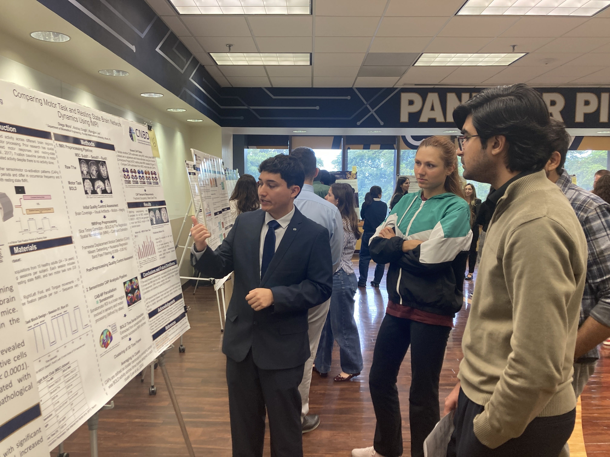
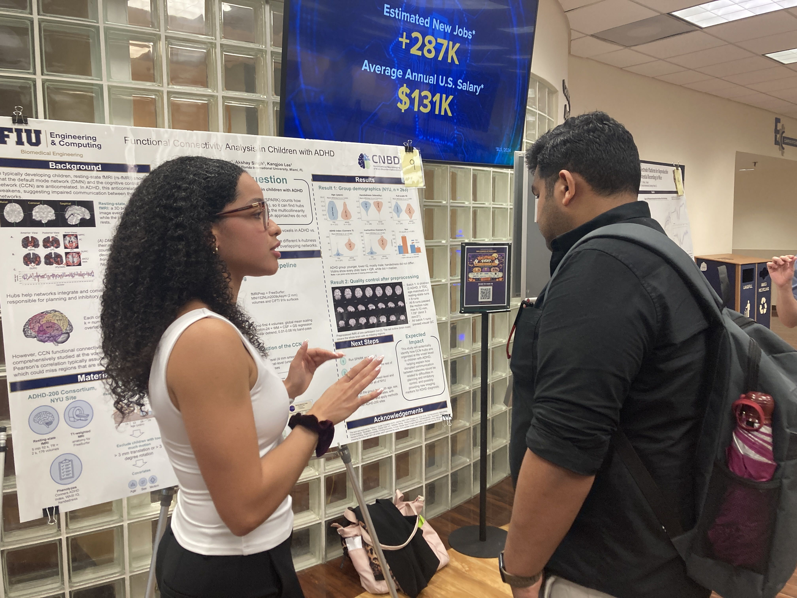
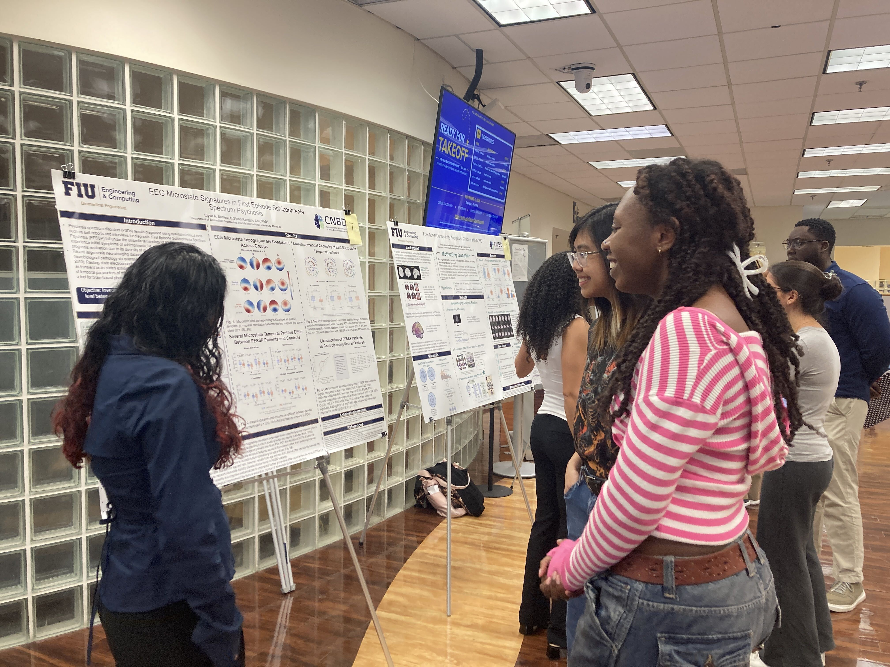
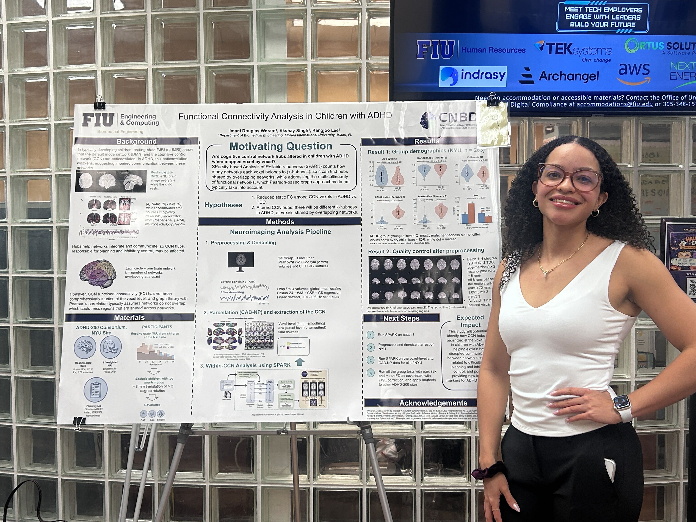
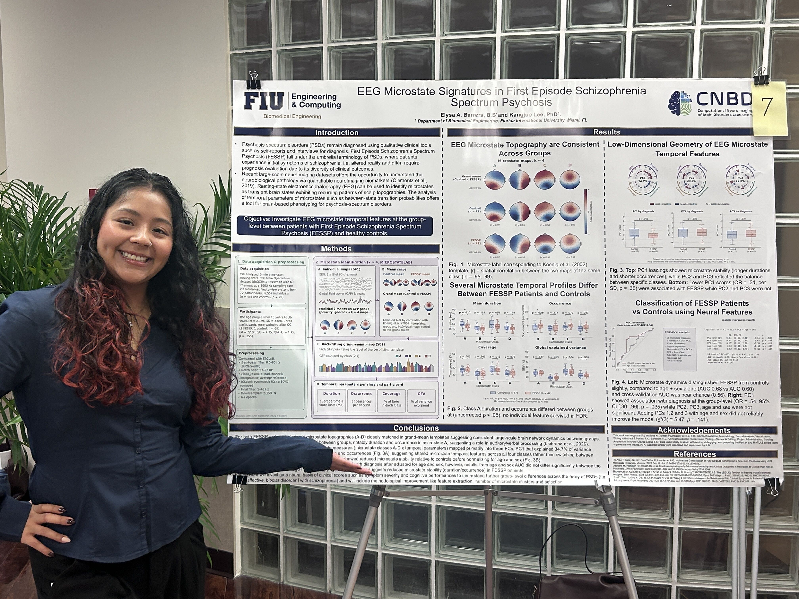
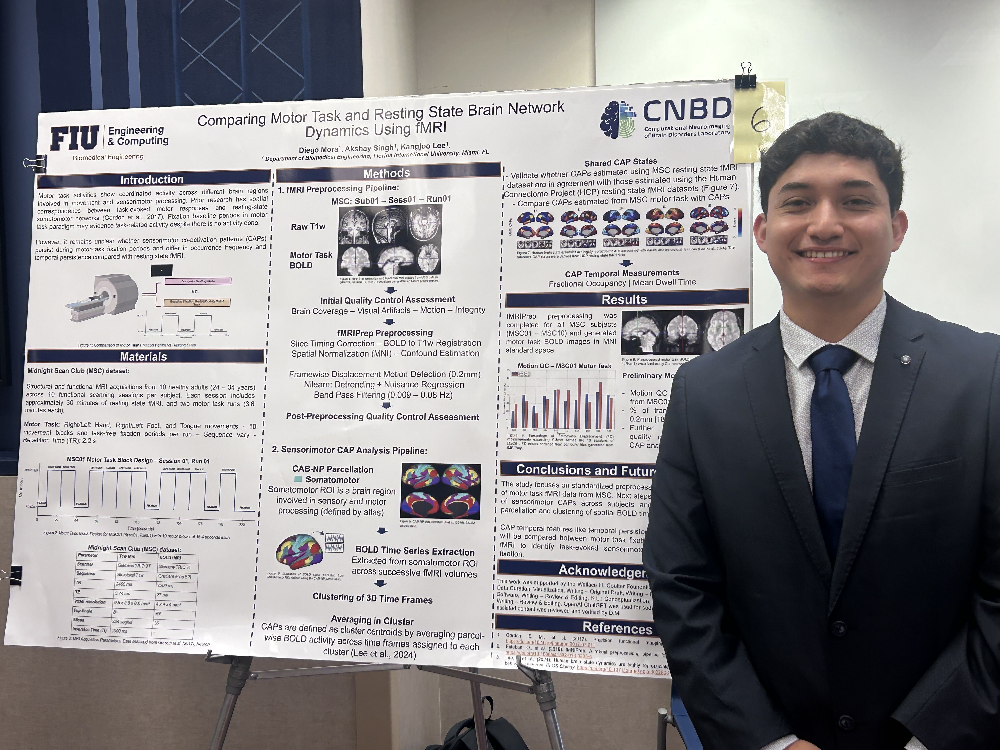



## Three undergraduate researchers from the CNBD Lab presented their research at the 2026 BME Undergraduate Research Day at FIU on November 6, 2026. Congratulations to our students on their excellent work! 

[Domestic Conference] Elysa Barrera and Kangjoo Lee. EEG Microstate Signatures in First Episode Schizophrenia Spectrum Psychosis. BME Undergraduate Research Day. November 6, 2026. Florida International University. Miami, Florida, USA.

[Domestic Conference] Diego Mora, Akshay Singh, Kangjoo Lee. Comparing Motor Task and Resting State Brain Network Dynamics Using fMRI. BME Undergraduate Research Day. November 6, 2026. Florida International University. Miami, Florida, USA.

[Domestic Conference] Imani Douglas Woram, Akshay Singh, Kangjoo Lee. Functional Connectivity Analysis in Children with ADHD. BME Undergraduate Research Day. November 6, 2026. Florida International University. Miami, Florida, USA.

Here are some moments from our students' research presentations and the BME Undergraduate Research Day!

## About the CNBD Lab

The CNBD Lab is dedicated to understanding brain disorders through advanced computational neuroimaging. We combine neuroimaging, data science, and engineering approaches to better characterize brain function, identify meaningful biomarkers, and ultimately improve diagnosis and treatment pathways.

### Lab Location

The CNBD Lab is part of the Department of Biomedical Engineering in the College of Engineering and Computing at Florida International University in Miami, FL. FIU provides a dynamic, diverse, and collaborative environment with strong connections to clinical partners and interdisciplinary research communities.

<iframe src="https://www.google.com/maps/embed?pb=!1m18!1m12!1m3!1d7186.020936595301!2d-80.37073722467673!3d25.770217777346506!2m3!1f0!2f0!3f0!3m2!1i1024!2i768!4f13.1!3m3!1m2!1s0x88d9bed56c5eb577%3A0xa9b1e17e3ac2d301!2sFIU%20College%20of%20Engineering%20%26%20Computing!5e0!3m2!1sen!2sus!4v1767193584248!5m2!1sen!2sus" width="600" height="450" style="border:0;" allowfullscreen="" loading="lazy" referrerpolicy="no-referrer-when-downgrade"></iframe>

